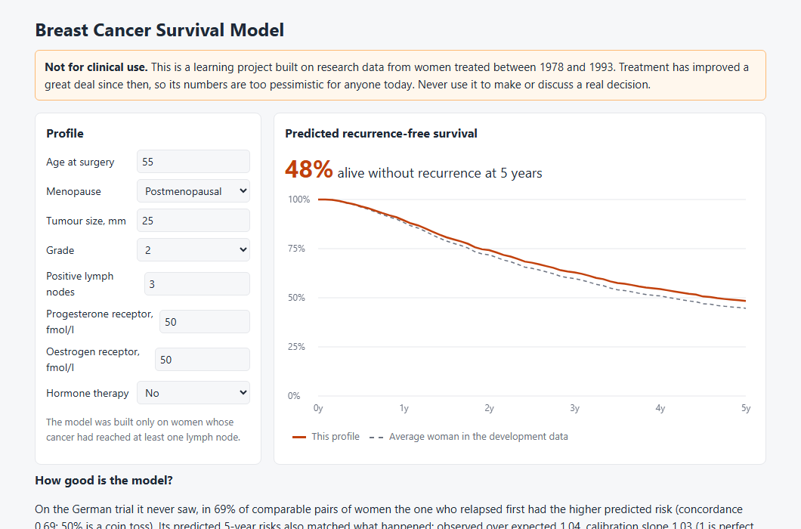
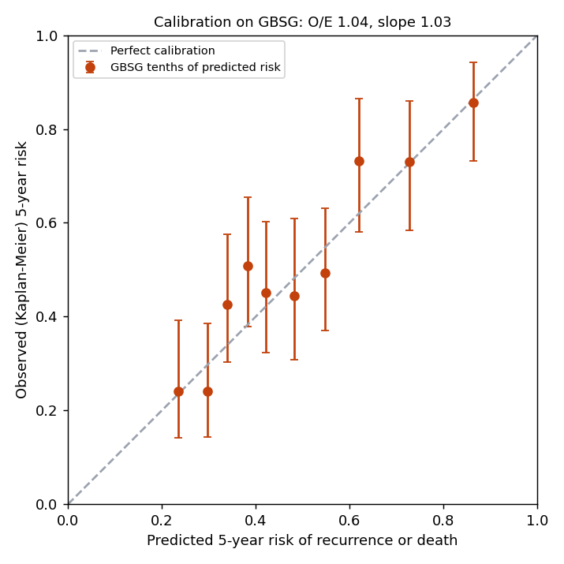
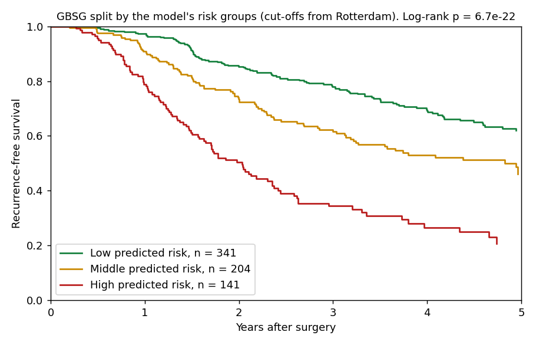
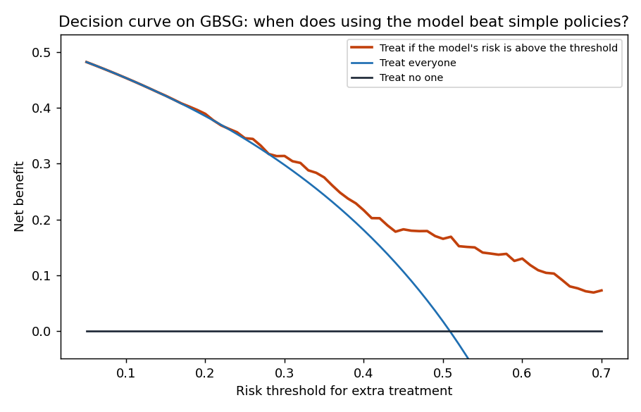
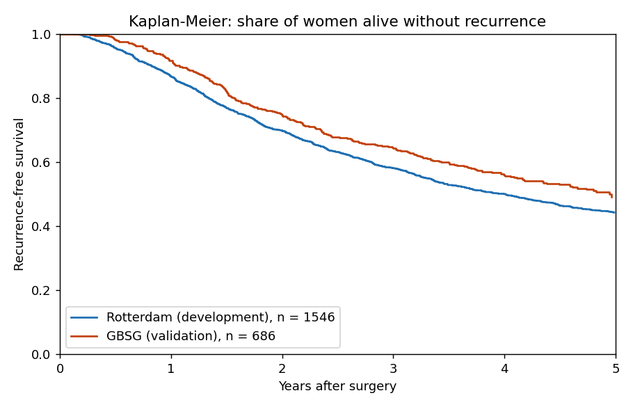
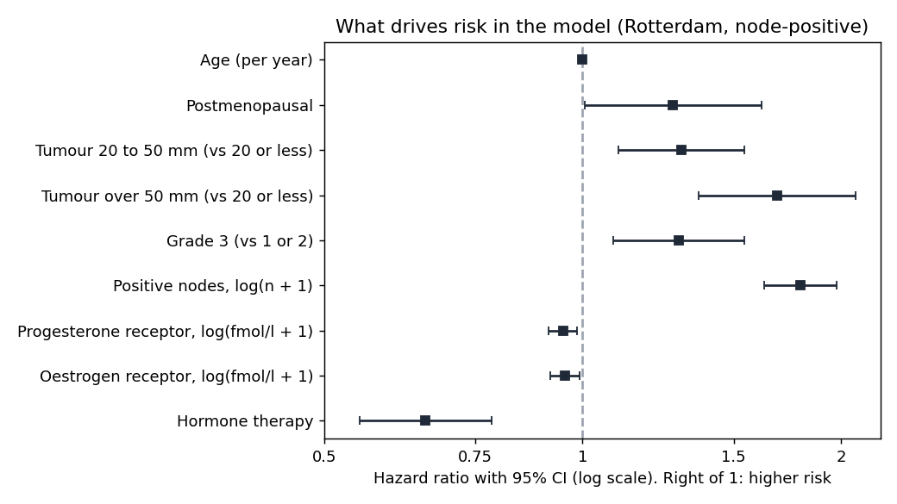
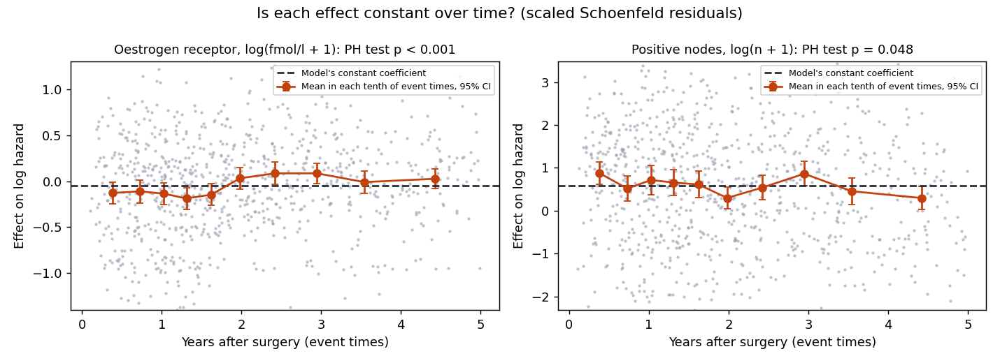

# Breast Cancer Survival Model

A model that predicts how likely a woman with node-positive breast cancer is
to be alive without recurrence 5 years after surgery. It is built on one
cohort (Rotterdam, the Netherlands) and tested, unchanged, on another (a
German trial). That is external validation, the step that tells you whether
a clinical prediction model works beyond the data it was built on.

**Try it:** https://rs-r06.github.io/Breast-Cancer-Survival-Model/ has a
calculator: enter a profile, see the predicted survival curve.

**Not for clinical use.** The data come from women treated between 1978 and
1993. Treatment has improved a great deal since then.

**How this was built:** I wrote this with Claude, Anthropic's AI assistant,
as a learning project. Claude wrote the first version of the code, tests and
this README. Every number below comes from running that code.



## Who it is for

Anyone learning survival analysis or how medical prediction models are
built and judged. It follows the steps a medical statistician would, and
every core method is written out by hand and checked against established
libraries.

## Results

| | Value | 95% CI |
|---|---|---|
| **Development**, Rotterdam node-positive | 1,546 women, 853 events by 5 years | |
| Concordance, apparent | 0.688 | |
| Concordance, corrected for optimism (200 bootstraps) | 0.685 | |
| **External validation**, GBSG trial | 686 women, 285 events by 5 years | |
| Concordance (Harrell, to 5 years) | 0.687 | 0.657 to 0.718 |
| AUC at 5 years | 0.736 | 0.677 to 0.788 |
| Scaled Brier score (index of prediction accuracy) | 0.169 | 0.096 to 0.235 |
| Observed / expected 5-year risk | 1.04 (50.8% vs 49.0%) | 0.95 to 1.13 |
| Calibration slope | 1.03 | 0.84 to 1.21 |

In plain words:

- **It ranks women sensibly.** In 69% of comparable pairs, the woman who
  relapsed first had the higher predicted risk (50% would be a coin toss).
  That is modest, and typical of models built from routine tumour
  features.
- **Its risks are honest on new data.** Across the German trial it
  predicted 49.0% would relapse or die within 5 years; 50.8% did. A
  calibration slope of 1.03 means the spread of predicted risks is right too:
  neither too extreme nor too timid.
- **It barely overfits.** Bootstrap optimism was 0.003 in concordance and
  the shrinkage factor 0.97, as expected with 853 events for 9 predictors.





The three risk groups, with cut-offs fixed on Rotterdam, separate clearly in
the German trial (log-rank p = 7 x 10^-22).



**Would it help a decision?** Decision curve analysis asks: if extra
treatment went to women above a risk threshold, would using the model beat
treating everyone or no one? On the German trial it does at nearly every
threshold from 15% up to 70%, the highest checked. Below 15% it is no better
than treating everyone.

## How to run it

```bash
pip install -r requirements.txt
python run.py
pytest
```

`run.py` downloads two small CSV files the first time and takes about a
minute. The tests also need `lifelines` and `statsmodels`, used only to check
the hand-written maths.

## Data

Both cohorts come with the R `survival` package (Therneau) and are fetched
from the Rdatasets collection. They are the pair Royston and Altman (2013)
used to show how to validate a survival model.

- **Development:** Rotterdam tumour bank, 2,982 women who had surgery for
  primary breast cancer between 1978 and 1993. The main model uses the 1,546
  whose cancer had reached the lymph nodes, to match the validation trial.
- **Validation:** German Breast Cancer Study Group 2 trial, 686 women with
  node-positive breast cancer, recruited 1984 to 1989.

The cohorts differ in ways that make the test a real one. Rotterdam was
followed for longer, and its pathologists graded far more tumours grade 3
(76% against 23%). Rotterdam has no grade 1 tumours, so grades 1 and 2 are
combined.

**The outcome** is recurrence-free survival: time to recurrence or death,
whichever comes first, cut off at 5 years. In Rotterdam, 43 women died after
their recurrence follow-up had ended. A recurrence in that gap could not have
been seen, so they are counted as censored at the end of recurrence
follow-up, as the `survival` package documentation describes.



## How it works

All the methods below are written out in `bcsurv/` and tested against
`lifelines` and `statsmodels`.

### Kaplan-Meier and the log-rank test (`bcsurv/km.py`)

The Kaplan-Meier estimate of survival multiplies, at each event time, the
share of those still at risk who did not have the event:
$S(t) = \prod_{t_j \le t} (1 - d_j / n_j)$, with Greenwood's variance and a
log(-log) confidence interval. The log-rank test compares observed and
expected events between groups.

### The Cox model (`bcsurv/cox.py`)

Each woman's hazard is a shared baseline times $\exp(x^\top \beta)$. Cox's
partial likelihood drops the unknown baseline:

$$L(\beta) = \prod_{\text{events } i} \frac{\exp(x_i^\top \beta)}{\sum_{j \in R(t_i)} \exp(x_j^\top \beta)}$$

The code maximises it by Newton-Raphson, using its gradient and Hessian
(Breslow's handling of tied times). Standard errors come from the inverse of
the information matrix. The baseline hazard is Breslow's estimator, and a
woman's predicted survival is $S(t \mid x) = S_0(t)^{\exp(\text{lp})}$.
Coefficients match `statsmodels` to 6 decimal places.

**Predictors,** all fixed before any fitting: age, menopause, tumour size,
grade, positive nodes, progesterone and oestrogen receptors (both on a
log(x + 1) scale), and hormone therapy.



Reading the log-scale effects: 9 positive nodes instead of 1 multiplies the
hazard by 2.57. Going from 0 to 100 fmol/l of oestrogen receptor multiplies
it by 0.80, and the same for progesterone receptor by 0.78. Hormone therapy
cuts it by a third (hazard ratio 0.66), though in Rotterdam it was not
randomised, so that is association, not proof of effect.

### Checking proportional hazards

The Cox model assumes each effect is constant over time. The Grambsch and
Therneau test, on scaled Schoenfeld residuals, rejects that overall (p < 0.001),
mainly because of the oestrogen receptor (p < 0.001).



The chart shows why: a high oestrogen receptor is protective in the first two
years and makes little difference after. This fading is a known feature of
breast cancer, not a flaw in the data. For a 5-year prediction the model
averages it, and the calibration on the German trial shows that average
works at 5 years. A model for shorter or longer horizons should let the
effect change with time.

### Validation measures (`bcsurv/validate.py`)

Following McLernon et al. (2023):

- **Discrimination:** Harrell's concordance up to 5 years, and the
  time-dependent AUC at 5 years.
- **Calibration:** observed against expected 5-year risk, the calibration
  slope (refit a Cox model on the linear predictor), and observed risk by
  tenths of predicted risk.
- **Overall:** the Brier score at 5 years and its scaled version.
- **Clinical use:** decision curve analysis with Kaplan-Meier net benefit.

Some women leave follow-up early, so their 5-year outcome is unknown. The
AUC and Brier score handle this by weighting each woman with a known outcome
by the inverse of her chance of still being followed up (IPCW). A test checks
that cutting follow-up at 5 years leaves these measures unchanged, which
caught a real bug during development.

**Internal validation:** Harrell's bootstrap refits the model 200 times on
resampled data to measure how much the development data flatter it.
**Intervals:** 1,000 bootstrap resamples of the validation patients.
**Sensitivity analysis:** a model built on all 2,982 Rotterdam women gives
almost the same validation results (concordance 0.687, O/E 1.03, slope 1.08).

## Limits

- The data are 30 to 45 years old. Absolute risks today are much lower;
  only the methods carry over.
- Hormone therapy was not randomised in Rotterdam, so its hazard ratio
  mixes treatment effect with who was offered treatment.
- Tumour grading differed between the two hospitals. The model stayed
  calibrated, but grade is the least portable input.
- Only the variables in both datasets could be used. Modern tools such as
  PREDICT also use HER2 status, Ki-67 and how the cancer was found.

## What I learned

[FILL IN: two or three sentences in your own words, once you have worked
through the code. For example: why external validation matters more than a
good fit, what the calibration slope tells you that concordance does not, or
what the fading oestrogen receptor effect means for the model.]

## Project layout

```
bcsurv/data.py       both cohorts, made comparable
bcsurv/km.py         Kaplan-Meier and the log-rank test
bcsurv/cox.py        Cox model by Newton-Raphson, Breslow baseline, Schoenfeld test
bcsurv/validate.py   concordance, AUC, Brier, calibration, decision curves, bootstraps
run.py               the whole study, charts and results/metrics.json
docs/                the calculator (GitHub Pages)
tests/               14 tests against lifelines, statsmodels and known answers
```

## References

- Royston, P. and Altman, D. (2013). External validation of a Cox prognostic model: principles and methods. BMC Medical Research Methodology 13:33.
- McLernon, D. et al. (2023). Assessing performance and clinical usefulness in prediction models with survival outcomes. Annals of Internal Medicine 176(1).
- Grambsch, P. and Therneau, T. (1994). Proportional hazards tests and diagnostics based on weighted residuals. Biometrika 81(3).
- Graf, E. et al. (1999). Assessment and comparison of prognostic classification schemes for survival data. Statistics in Medicine 18.
- Vickers, A. et al. (2008). Extensions to decision curve analysis. BMC Medical Informatics and Decision Making 8:53.
- Therneau, T. A Package for Survival Analysis in R (the `survival` package and its data).

## Author

Rehumile Sechele, rehumiles@gmail.com
